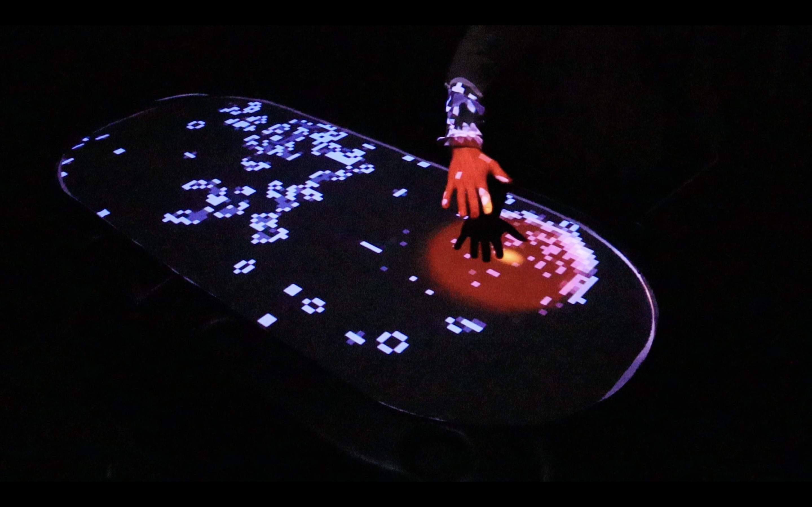
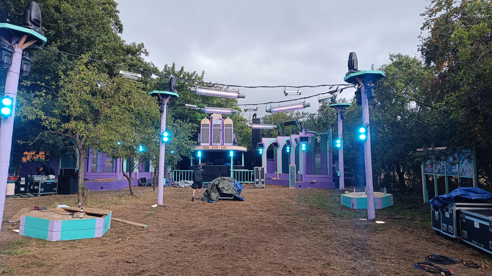
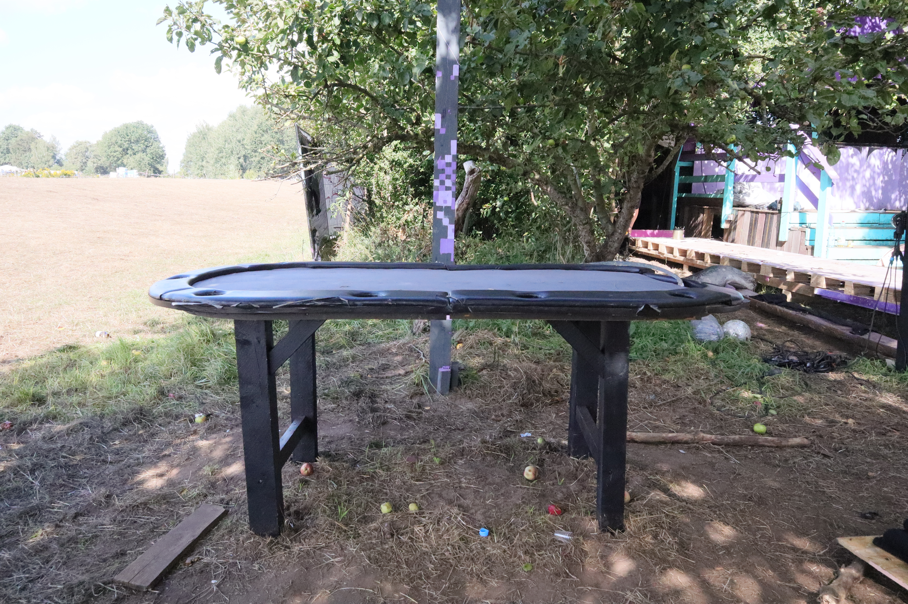
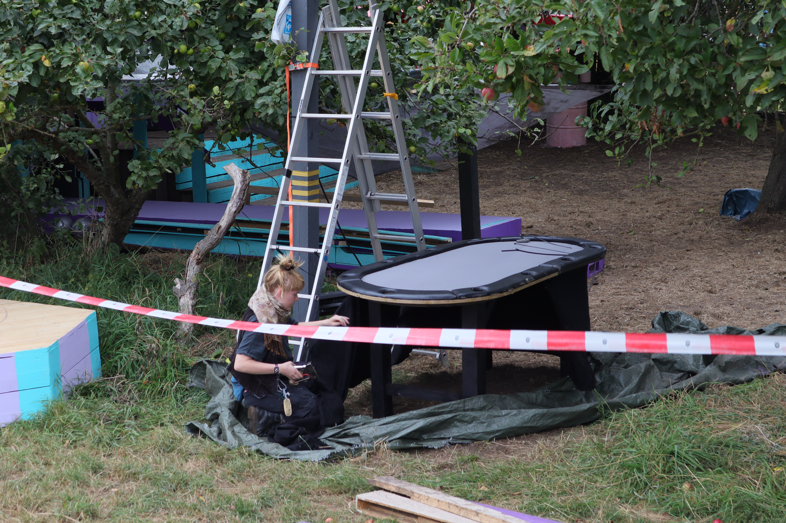
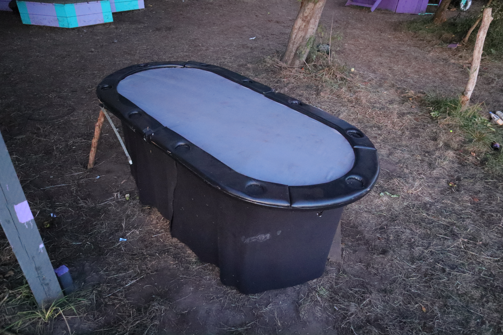
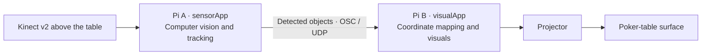
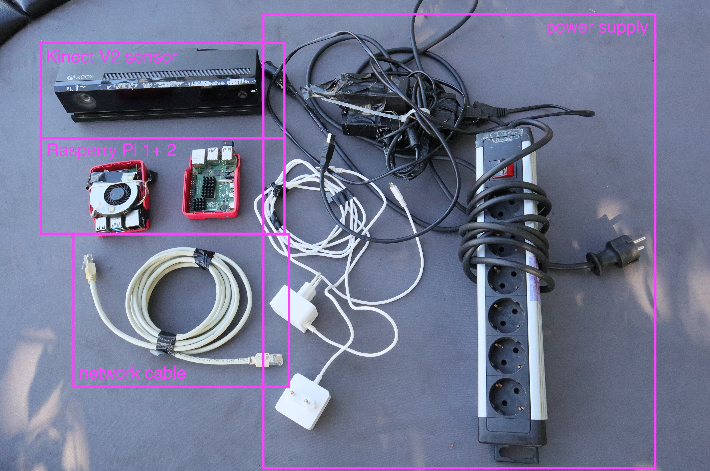
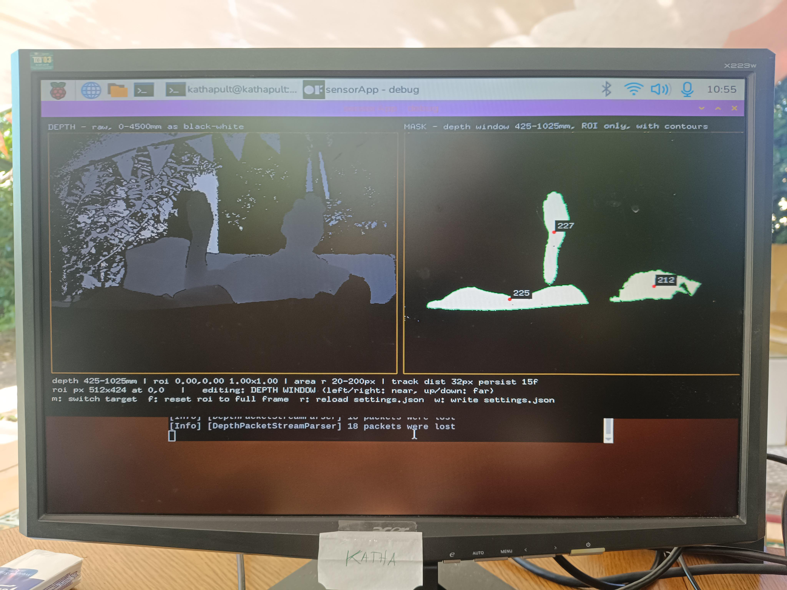
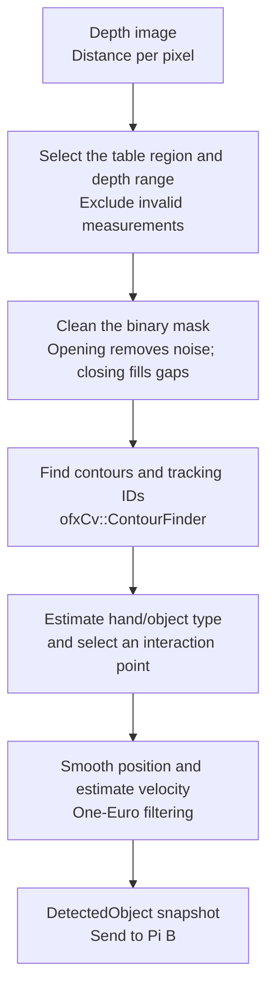
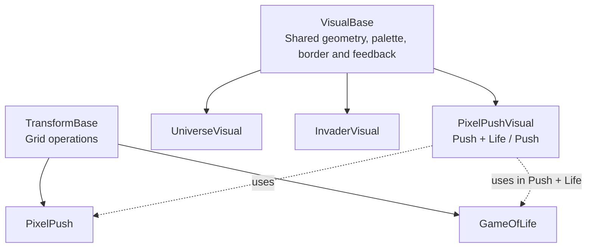

# *The Last Game of Moyn* - an interactive Poker Table Festival Installation

*Second Term Project · Creative Technologies · Katharina Kleinhans*

<!-- Submission draft: add your name, representative PNGs, and a video/build or experience link. Revisit the example reflection and lessons learned before submission. -->

## 1. Summary 

*poker table at moyn festival*

*The Last Game of Moyn is an interactive projection for a poker table, developed in the context of a festival installation at "(M)Wilde Hilde" stage on [Moyn Festival](https://moynfestival.de/) . Visitors move their hands over the table to push pixels, influence evolving patterns, navigate an imaginary universe, or play an arcade game. A Kinect v2 observes the surface from above, while two Raspberry Pi 4s divide the work of computer vision and rendering.*

For me, the project was an opportunity to explore computer vision and Raspberry Pis through a concrete installation idea. It builds on my CC2 submission, a hand-controlled openFrameworks application using Leap Motion and *Conway’s Game of Life*. This project took that starting point into a physical setup with different hardware, a custom detection pipeline, and four visual modes. Alongside the visuals, a large part of the work became understanding how sensing, networking, projection, and operation fit together. Claude Code supported the implementation, with Spec Kit helping structure the larger architectural changes.

## 2. Concept

*(M)Wilde Hilde stage at Moyn Festival 2026*

### Starting point and motivation

In CC2, I wanted to move from working with motion data in TouchDesigner towards processing it in C++ and openFrameworks. The result was a modular application in which Leap Motion hand data influenced pixel-based visuals and Game of Life. The idea of projecting onto a poker table already existed then; this project became the next step towards that installation.

[CC2 Final Project: *Conway's Game of Life - Leap Motion edition* 👾](https://github.com/kathapult/CC2_FinalProject.git)

**From leap motion to Kinect V2:** The Leap Motion already offers much of the movement interpretation ready to use: e.g. hands, fingers, and grab values. Moving to a Kinect meant working with **depth images** and **computer vision**. Running the installation on Raspberry Pis added another learning area: Linux, hardware compatibility, communication between Rasperry Pis and the practical limits of it.

### (M)Wilde Hilde Stage: The table as an interface

Friends of mine are organizing the "(M)Wilde Hilde" stage on the [Moyn Festival](https://moynfestival.de/) for the last time in 2026. The stage was build up for the third time in different variations of aretro-futuristic casino with a slot machine and should be extended with small installations / gimmicks. The poker table was an idea to create ashared digital playground in the back of the dance floor. 

The interaction should be discoverable through movement. Pushing pixels follows a physical action; steering a spaceship introduces a more playful translation. Different modes offer different relationships between control and surprise: some preserve what a visitor changes, others continue evolving independently, and the arcade game adds points and the possibility of losing.

Violet, lilac, turquoise, and salmon connect the visuals to the surrounding installation. A shared animated border and hand feedback help the modes feel like parts of the same table.

<!-- Image idea: overall installation, showing the table, projection, and sensor mounting. -->

## 3. Implementation

### System overview

The application uses **C++17 and openFrameworks 0.12.1** on two Raspberry Pi 4s running Linux ARM64. A direct Ethernet cable connects them, so the interaction does not depend on the venue’s Wi-Fi.

- **Pi A — sensing:** reads the Kinect, detects and tracks shapes, and sends the results.
- **Pi B — rendering:** receives detected objects and renders the four visual modes.
- **Shared data — `DetectedObject`:** ID, normalized position, height, area, velocity, age, and approximate hand/object classification.

Splitting the work keeps detection from competing with rendering on one Pi. This extends a useful decision from CC2: separating sensor input from visual logic. The original `HandData` became `DetectedObject`, because the Kinect pipeline detects foreground shapes rather than providing a detailed hand skeleton. The visuals only read this shared data, keeping camera and network details outside their logic.

### Raspberry Pis: *Getting the hardware running*

Getting the inherited application onto the Pi involved several steps before I could work on interaction:

- **Remove Leap Motion dependencies** so the application could build for the new platform.
- **Switch from Wayland to X11** after the application built successfully but failed to open its window.
- **Connect the Kinect with a powered USB 3 adapter** and set up a compatible driver.
- **Use the Jyurineko fork of `libfreenect2`**, with an OpenGL ES 3.1 backend compatible with the Pi’s graphics capabilities, without relying on CUDA or OpenCL.
- **Verify live camera streams with `Protonect`** before integrating the driver directly through the application’s `KinectInput` class.

### Computer Vision: *From depth image to interaction*

The pipeline uses depth rather than RGB colour. The main steps turn the camera’s distance measurements into a small set of interaction points:

**Hand classification** combines practical clues for this setup:

- Physical palm size and contour solidity, which describes how compact a shape is.
- Contact with the table boundary, where an arm reaches onto the surface.
- Movement over time: stationary tracks become objects after five seconds and are hidden from the outgoing stream after ten seconds.

Finding the interaction point required more experimentation. A contour’s centre can lie on the forearm instead of the hand. The implementation developed from a palm estimate towards a point near the inward end of a contour entering from the table edge, with palm and centre fallbacks when the estimate is ambiguous. Adaptive One-Euro filtering reduces jitter while allowing faster movements through more directly.

Two later additions make the detection more specific to the physical setup:

- **Rounded table mask:** excludes the areas outside the table’s curved edges.
- **Optional empty-table depth reference:** provides a local surface depth for detecting hands above a slightly uneven or tilted table, where one global threshold is too restrictive.

### Communication, calibration, and projection

These three parts connect the detected movement to the place where visitors see its effect:

| Part | Implementation | Purpose |
| --- | --- | --- |
| **Object stream** | Full snapshots over OSC/UDP on port 8000; publish only complete frames. | Distinguish an empty table from missing data. |
| **Update gaps** | Brief, bounded extrapolation between sensor updates. | Bridge the slower sensor stream and faster rendering loop. |
| **Calibration** | Explicit maintenance mode on Pi B, with separate preview and control channels. | Inspect depth, masks, and tracks; adjust Pi A without attaching a monitor to it. |
| **Coordinate mapping** | Rotate or mirror sensor coordinates once before passing them to the visuals. | Keep movement consistent across all modes. |
| **Projection** | Native 1024 × 768 output with adjustable viewport, rotation, and table proportions. | Fit the image to the physical surface. |

Calibration became part of the working process: I could inspect what the sensor saw and compare it with the projection. The production profile keeps these overlays off. The documented starting dimensions are a **214 × 105 cm table** with a **188 × 79 cm projection area** inside its margin; site calibration can adjust the projected geometry.

### Visual structure and operation

The class structure separates drawing from grid operations. In this diagram, solid arrows indicate inheritance; dotted arrows show which operations a visual uses.

Universe navigation and the Invaders game use their own helper classes. Keeping these responsibilities separate let me change interaction behaviour without rebuilding the whole visual structure.

For operation, the implementation includes:

- **systemd services** to start and supervise both applications.
- **Release updates** that build before stopping the existing application, switch atomically, and provide rollback handling.
- **Persistent calibration** stored separately from releases, so updates preserve the setup.

These mechanisms are implemented; their full hardware validation remains part of the outstanding checks.

### AI-supported workflow

I used Claude Code to support implementation, debugging, and understanding the growing C++ codebase. Spec Kit helped structure the two-Pi split into **specification → research and plan → tasks → implementation**. A project constitution recorded boundaries such as separating sensor processing from visuals and respecting the Pi’s platform limits.

My contribution involved defining the experience, choosing between approaches, testing at the table, and bringing observations back into the next iteration. AI assistance made a larger technical exploration possible, but generated code still needed checking against the installed libraries and real hardware. The final spaceship sprite was also generated with AI from a supplied Fusion rocket reference. This documentation draft was prepared with Codex from the repository and process log and requires my final editorial review.

## 4. Important process insights

### Seeing intermediate stages changed the workflow

At first, a missing reaction on Pi B could mean almost anything: an unsuitable depth range, a rejected contour, a lost track, or missing network data. Depth and mask previews, tracking measurements, and diagnostic overlays made those stages visible. Calibration became much more productive once I could see why something was being detected or rejected.

### Testing changed the interaction design

Several problems only became clear at the table. Invaders initially stayed in demo mode because misclassified hands were ignored and brief detection gaps repeatedly reset the takeover timer. Tracking continuity and a more tolerant selection policy addressed that failure. Averaging multiple hands also caused sudden steering changes when another person reached in, leading to one controlling track at a time in Universe and Invaders.

The space visuals went through several control approaches, including swimming, absolute steering, and four directional zones. The current Universe implementation uses a continuous drag from a personal starting point. These iterations showed how much the feeling of control depends on the mapping, even when the same sensor data is available.

### Performance and aesthetics influenced each other

An early PixelPush version almost stalled the Pi. The investigation traced this to accumulating tiny, invisible floating-point values and unnecessary processing. Removing those values and limiting work to active regions was followed by a documented table run at around 60–75 fps. That was a result for that iteration, rather than a benchmark for every final mode.

Pushing and Game of Life also pulled in different directions: pushing gathers material, while Conway’s overcrowding rule destroys dense clusters. Keeping both a push-only mode and a push-with-life mode made this tension part of the experience. The visual selection was reduced from an exploratory collection of eight modes to four, removing redundant screens and a labelled solar-system view that needed too much explanation.

## 5. Results

The project developed from the CC2 application into a two-device installation codebase with a custom depth-based interaction pipeline, projection calibration, and four modes:

| Mode | Experience |
| --- | --- |
| **Push + Life** | Hands move pixel material and revive cells while cellular rules evolve the field. The current sequence moves from Conway to Maze and a curated dynamic rule. |
| **Push** | Hands rearrange pixel material into paths and heaps that remain after the movement stops. |
| **Universe** | A continuous flight through pixelated rings, orbs, mushrooms, and festival references. One hand steers; height and a two-hand separation gesture influence speed. |
| **Invaders** | A hand steers an automatically firing spaceship against falling pixel objects. Power-ups, increasing difficulty, a demo, and session high scores support repeated play. |

Automatic production rotation waits for a quiet period before changing modes, allowing an ongoing interaction to finish. Shared colours, table masking, and feedback connect the different experiences visually.

The process log records a working end-to-end sensor/visual connection and repeated tests at the physical table. It also records offline C++ tests and Python protocol probes for parts such as frame assembly, coordinate mapping, detection geometry, steering, and game policies. Later entries explicitly leave full Pi builds and hardware checks open for several refinements. The repository therefore documents both demonstrated progress and implemented features awaiting final confirmation; it does not establish a completed long-duration exhibition test.

**To add: final installation observations, actual operating duration, remaining issues, and visitor feedback.**

**Submission media to add:**

- At least two representative **PNG images**: an overall installation view and a close-up showing interaction.
- A short video or another accessible representation that lets the project be experienced without the complete hardware setup.
- A repository/submission link providing access to all source files.

<!-- Additional image idea: depth/mask preview beside its visual response, explaining the otherwise invisible CV process. -->

## 6. Discussion & project reflection

*Brief example text — revisit after adding the final installation experience.*

The project brought together the areas I wanted to explore: computer vision, Raspberry Pis, and interaction in a physical space. Building on CC2 gave me a visual and structural starting point, but moving to different hardware introduced much more setup and calibration work than the original application suggested. A substantial part of the creative process happened through making the input usable.

The most convincing interactions were those where the relationship between movement and response was easy to discover. More complex navigation needed repeated changes, and tracking limitations continued to affect the experience. Small or slowly moving hands remain a point for further testing. The design also raises a question about the shared table: several people can influence the pixel field, while Universe and Invaders give control to one track. I would like to evaluate how understandable that difference is to visitors.

AI support helped me work beyond my current C++ experience, while making it important to distinguish code I could explain from code I had only accepted. For future work, I would prioritise testing with unfamiliar visitors, recording detection failures, and validating long-duration operation before adding further modes.

## 7. Lessons learned

*Brief example text — adapt to your own conclusions.*

- **A depth image still needs interpretation.** Choosing a region, cleaning a mask, tracking shapes, and finding a useful control point all affect what a hand movement becomes.
- **Calibration is part of the design.** Visible intermediate data and adjustable settings made experimentation possible without rebuilding for every change.
- **The real hardware decides.** A clean build or desktop simulation cannot establish projection quality, performance, or how an interaction feels at the table.
- **Modularity helped the project change direction.** The CC2 separation between input and visuals supported a new sensor, two devices, and several interaction experiments.
- **Reducing scope improved clarity.** Four distinct modes gave the installation a clearer identity than the larger exploratory collection.
- **AI was most useful alongside testing and understanding.** Plans and generated code helped me progress; observations at the table determined what needed to change.

<!-- Background for final editing: processDocumentation.md contains the development history; projectDescription.md describes the earlier CC2 project. Current technical details are in sensorApp/, visualApp/, shared/, calibrationMode.md, and deployment/startSkript.md. Submission requirements are in secondTermProject_README.md. -->
