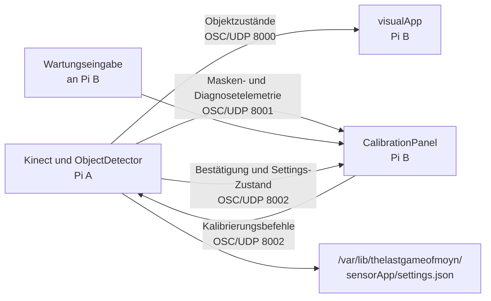

# Plan: Visuelle Sensorkalibrierung auf Pi B

**Status:** Statisch implementiert; Pi-/Kinect-/Projektorabnahme offen  
**Stand:** 2026-08-17  
**Betroffene Rollen:** Pi A (`sensorApp`) und Pi B (`visualApp`)

## Ziel

Die Kinect- und Detektionskalibrierung soll vollständig auf der Projektion von Pi B sichtbar und
während einer Wartungssitzung dort bedienbar sein. Pi A bleibt ohne Monitor und Eingabegeräte.

Pi A bleibt weiterhin allein verantwortlich für Kinect-Zugriff, Computer Vision,
`DetectionSettings` und deren dauerhafte Speicherung. Pi B wird ausschließlich zur
Kalibrierungskonsole: Es zeigt die von Pi A gelieferten Diagnoseinformationen an und sendet klar
begrenzte Kalibrierungsbefehle zurück.

Die produktive Rendering-Pipeline und der bestehende Objektstrom dürfen durch die Kalibrierung
nicht verändert werden.

## Ausgangslage

Der derzeitige Kalibrierungsmodus ist nur teilweise für einen kopflosen Pi A geeignet:

- `sensorApp-calibration.service` startet Pi A mit `--preview`.
- Pi A sendet die binäre Detektionsmaske auf UDP-Port 8001.
- `visualApp-calibration.service` startet Pi B mit `--diagnostics`.
- Pi B zeigt HUD und Masken-Preview an.
- Die eigentlichen `DetectionSettings` können auf Pi B weder verändert noch gespeichert werden.
- Die lokale Tastaturkalibrierung in `sensorApp --debug` benötigt einen Monitor und Eingabegeräte
  an Pi A und ist damit am Installationsort nicht nutzbar.
- Der Preview enthält nicht alle Informationen aus `sensorApp/src/DebugView.cpp`, insbesondere
  nicht das rohe Tiefenbild und die detaillierten Klassifikations- und Trackerwerte.

## Zielarchitektur

Die Kalibrierungsoberfläche bleibt in `visualApp/ofApp` außerhalb der `VisualBase`-Unterklassen.
Damit sehen die eigentlichen Visuals weiterhin ausschließlich `std::vector<DetectedObject>` und
erhalten keinen Zugriff auf Sensor-, CV- oder Netzwerkklassen.

## 1. Eigenständiger Kalibrierungsvertrag

Für den Rückkanal wird ein neuer, von `ObjectStreamProtocol` getrennter Vertrag eingeführt:

- neuer gemeinsamer Header `shared/CalibrationProtocol.h`,
- neuer lesbarer Vertrag
  `specs/001-dual-pi-sensor-split/contracts/osc-calibration-control.md`,
- UDP-Port 8002 ausschließlich für Kalibrierungsbefehle, Zustände und Bestätigungen,
- keine Änderung an den bestehenden Nutzlasten auf Port 8000,
- die bestehende Masken-Preview auf Port 8001 bleibt für ältere Gegenstellen lesbar.

### Vorgesehene Nachrichten

| Nachricht | Richtung | Zweck |
| --- | --- | --- |
| `get` | Pi B → Pi A | Vollständigen aktuellen Settings-Zustand anfordern |
| `set` | Pi B → Pi A | Einen absoluten Parameterwert temporär setzen |
| `save` | Pi B → Pi A | Aktuelle Werte dauerhaft speichern |
| `reload` | Pi B → Pi A | Persistierte Werte neu laden und temporäre Änderungen verwerfen |
| `reset-roi` | Pi B → Pi A | ROI auf den vollständigen Tiefenframe zurücksetzen |
| `state` | Pi A → Pi B | Vollständigen, von Pi A validierten Zustand veröffentlichen |
| `result` | Pi A → Pi B | Erfolg oder Fehler einer konkreten Anfrage bestätigen |

Jede Anfrage trägt mindestens eine Anforderungs-ID. Änderungsbefehle enthalten zusätzlich die
zuletzt bestätigte Revision. Pi A erhöht die Revision nach jeder angenommenen Zustandsänderung.
Veraltete Änderungen werden abgelehnt und mit dem aktuellen Zustand beantwortet.

`set` überträgt immer einen absoluten Wert und niemals nur Befehle wie „erhöhe um einen Schritt“.
Damit bleibt eine Übertragung idempotent: Ein wiederholtes UDP-Paket verändert den Wert nicht
mehrfach. Pi B wiederholt unbeantwortete Anfragen mit derselben ID; Pi A erkennt Duplikate und
liefert dasselbe Ergebnis erneut.

Unbekannte Feldkennungen werden ignoriert oder ausdrücklich abgelehnt. Neue Felder können dadurch
angehängt werden, ohne ältere Gegenstellen zur Fehlinterpretation bestehender Werte zu bringen.

## 2. Änderungen auf Pi A

### Startprofil

`sensorApp` erhält ein explizites Startprofil `--calibration`. Dieses Profil aktiviert gemeinsam:

- die bestehende Masken-Preview,
- zusätzliche Diagnosetelemetrie,
- den Calibration-Control-Empfänger auf Port 8002.

Der bestehende Parameter `--preview` bleibt zunächst als rein lesendes Diagnoseprofil erhalten.
Der Produktionsstart öffnet weder Port 8001 noch Port 8002.

### CalibrationControlServer

Eine neue Klasse `sensorApp/src/CalibrationControlServer.h/.cpp` übernimmt:

1. OSC-Nachrichten nicht blockierend empfangen,
2. die Quell-IP exakt gegen die konfigurierte Pi-B-Adresse prüfen,
3. Adresse, Version, Argumentanzahl und Argumenttypen prüfen,
4. Anforderungs-ID und Revision prüfen,
5. Befehle in Änderungen an `DetectionSettings` übersetzen,
6. die Werte durch `DetectionSettings::sanitize()` begrenzen,
7. sie über `ObjectDetector::setSettings()` sofort aktivieren,
8. Ergebnis und vollständigen bestätigten Zustand an Pi B senden.

Die Verarbeitung muss auch dann stattfinden, wenn gerade kein frischer Kinect-Frame eintrifft.
Der Control-Server wird deshalb in `sensorApp/ofApp::update()` vor einem möglichen frühen Rücksprung
wegen `FrameStatus != FreshFrame` aktualisiert.

### Persistenz

Pi A bleibt die einzige Instanz, die
`/var/lib/thelastgameofmoyn/sensorApp/settings.json` verändert.

- `set` ändert nur den laufenden Zustand und markiert ihn als ungespeichert.
- `save` schreibt den bestätigten Zustand dauerhaft.
- `reload` liest die persistente Datei erneut und verwirft ungespeicherte Änderungen.
- Ein Schreibfehler wird an Pi B gemeldet und darf nicht als gespeicherter Zustand erscheinen.

`DetectionSettings::save()` wird auf atomisches Schreiben umgestellt: temporäre Datei im selben
Verzeichnis schreiben, Inhalt schließen und anschließend auf den Zielnamen umbenennen. Eine
abgebrochene Speicherung darf keine teilweise geschriebene JSON-Datei hinterlassen.

## 3. Diagnosetelemetrie von Pi A

Die aktuelle binäre Maske reicht für Tiefenfenster, ROI und Morphologie, aber nicht für alle
Parameter. Für eine funktional vergleichbare Ansicht zu `DebugView` sendet Pi A zusätzlich:

- ein verkleinertes Graustufenbild des rohen Tiefenframes,
- den aktiven, bereinigten `DetectionSettings`-Zustand,
- pro akzeptiertem Track:
  - Tracker-ID und Typ,
  - rohes und geglättetes Zentrum,
  - Geschwindigkeit,
  - Palmradius in Millimetern,
  - Solidity,
  - Randkontakt,
  - Stillstandsdauer,
  - Hidden-Zustand.

Pi B führt daraus keine eigene Konturerkennung oder Klassifikation aus. Es zeichnet ausschließlich
die von Pi A berechneten Diagnosedaten. Dadurch bleibt die gesamte CV-Pipeline auf Pi A.

Das bestehende `/preview`-Format für die Maske bleibt unverändert. Das Tiefenbild erhält eine neue
Adresse auf Port 8001, sodass ein älterer Empfänger die unbekannten Pakete ignoriert und weiterhin
nur die Maske anzeigt. Bilder werden wie bisher in MTU-sichere Streifen zerlegt und erst nach
vollständigem Empfang atomar veröffentlicht.

## 4. Änderungen auf Pi B

### Startprofil

`visualApp` erhält ein Startprofil `--calibration`. Es umfasst:

- die bisherigen Funktionen von `--diagnostics`,
- den Calibration-Control-Client,
- das neue `CalibrationPanel`,
- den Empfang der erweiterten Diagnosetelemetrie.

`--diagnostics` kann als rein lesendes Profil bestehen bleiben. Der Produktionsstart akzeptiert
keine Kalibrierungsbefehle, öffnet Port 8002 nicht und zeigt keine Kalibrierungsoberfläche.

### CalibrationControlClient

Eine neue Klasse `visualApp/src/CalibrationControlClient.h/.cpp` übernimmt:

- Anfragen mit eindeutiger ID senden,
- ausstehende Anfragen mit Zeitstempel verwalten,
- unbeantwortete Anfragen begrenzt wiederholen,
- Quell-IP, Protokollversion, Revision und Antworttypen prüfen,
- ausschließlich vollständig validierte Zustände veröffentlichen,
- Verbindungs-, Timeout- und Fehlerstatus für die Oberfläche bereitstellen.

Die Oberfläche arbeitet mit bestätigten Werten von Pi A. Während eine Änderung aussteht, kann der
gewünschte Wert zusätzlich als „ausstehend“ angezeigt werden; er darf aber nicht als wirksam oder
gespeichert gelten, bevor Pi A ihn bestätigt hat.

### CalibrationPanel

Eine neue Klasse `visualApp/src/CalibrationPanel.h/.cpp` zeichnet über dem aktiven Visual:

- rohes Tiefenbild und binäre Maske nebeneinander,
- ROI-Rahmen und abgedunkelte Bereiche außerhalb der ROI,
- rohe und geglättete Zentren,
- Track-ID, Typ und Klassifikationsmesswerte,
- aktuelle Parametergruppe und alle bestätigten Werte,
- Verbindungszustand, Session, Revision und Preview-Alter,
- Status `gespeichert`, `geändert`, `ausstehend` oder `Fehler`,
- Tastenhilfe für die laufende Kalibrierung.

Die Darstellung wird von `visualApp/ofApp` aufgerufen. Sie darf weder aus einer
`VisualBase`-Unterklasse erreichbar sein noch Werte in den normalen Visual-Datenfluss einspeisen.

### Bedienung

Die bestehende Bedienlogik der lokalen DebugView wird übernommen:

| Taste | Funktion |
| --- | --- |
| `m` | Parametergruppe wechseln |
| Pfeiltasten | Werte der aktiven Gruppe verändern |
| `f` | ROI auf den vollständigen Frame zurücksetzen |
| `r` | persistierte Werte von Pi A neu laden |
| `w` | bestätigte Werte auf Pi A dauerhaft speichern |
| `Esc` | ungespeicherte Änderungen durch Reload verwerfen |
| `d` | Textdiagnose umschalten |
| `p` | Bilddiagnose umschalten |

Die vorhandenen Schrittweiten aus `sensorApp/ofApp.cpp` bleiben die gemeinsame fachliche Vorgabe.
Sie werden im gemeinsamen Kalibrierungsvertrag oder in einer kleinen gemeinsamen Hilfsstruktur
definiert, damit Pi A und Pi B nicht mit unterschiedlichen Schritten arbeiten.

Solange das `CalibrationPanel` fokussiert ist, konsumiert es alle Tastendrücke. Eine unbelegte Taste
darf dann weder ein Visual verändern noch zum nächsten Visual wechseln. Der Wechsel des aktiven
Visuals erhält eine eigene, ausdrücklich dokumentierte Taste.

Die Bedienung setzt ein temporäres Eingabegerät an Pi B voraus, beispielsweise eine USB-Tastatur.
Falls auch Pi B ohne Eingabegerät betrieben werden soll, muss derselbe Control-Client zusätzlich als
SSH-CLI oder gesicherte Wartungsoberfläche auf einem Laptop angeboten werden; die Anzeige auf Pi B
kann unverändert bleiben.

## 5. Sicherheit und Betriebsgrenzen

- Der Rückkanal ist ausschließlich im expliziten Kalibrierungsprofil aktiv.
- Pi A akzeptiert nur die konfigurierte Pi-B-Adresse; Pi B akzeptiert nur die konfigurierte
  Pi-A-Adresse.
- Es gibt keinen ungefilterten Fallback.
- Ungültige, unbekannte, nicht endliche oder außerhalb des erlaubten Bereichs liegende Werte werden
  abgelehnt oder durch die vorhandene Sanitisierung begrenzt und anschließend bestätigt.
- Pi B schreibt niemals direkt in die persistente Settings-Datei.
- Produktion bindet die Ports 8001 und 8002 nicht.
- Preview- oder Control-Paketverlust darf den Objektstrom auf Port 8000 nicht blockieren oder
  verändern.
- Ein Senderneustart erzeugt eine neue Session-ID. Zustände oder Bestätigungen einer alten Session
  dürfen danach nicht mehr angewendet werden.

## 6. Deployment

Folgende Betriebsdateien werden angepasst:

- `deployment/sensorApp-calibration.service`
- `deployment/visualApp-calibration.service`
- bei neuen Environment-Schlüsseln beide `.env.example`-Dateien,
- `deployment/install-role-deployment.sh`, falls neue Dateien installiert werden,
- `deployment/update-app.sh`, damit Rollen-Payload und Pfadfilter vollständig bleiben,
- `deployment/startSkript.md` mit Start, Bedienung, Diagnose, Ende und Fehlerfällen.

Die Kalibrierungs-Units bleiben nicht aktivierbare Wartungsdienste ohne `[Install]`-Abschnitt. Ihre
Konflikte mit Produktionsdienst und Update-Timer bleiben erhalten. Nach der Kalibrierung werden
Hauptdienst und Timer weiterhin ausdrücklich gestartet; ein Neustart kehrt ebenfalls ausschließlich
zum Produktionsprofil zurück.

Für eine rollende Aktualisierung gilt:

- Ein neuer Pi B muss bei einem alten Pi A „Kalibrierungssteuerung nicht verfügbar“ anzeigen und
  darf nicht hängen.
- Ein neuer Pi A sendet die bestehende Masken-Preview weiterhin in der bisherigen Form.
- Ein alter Pi B ignoriert neue Diagnoseadressen.
- Der Objektvertrag auf Port 8000 bleibt unverändert.

## 7. Implementierungsreihenfolge

1. Kalibrierungsfelder, Revisionen, Session- und Anforderungs-IDs im gemeinsamen Vertrag definieren.
2. Reinen C++-Protokolltest für Validierung, Revisionen, Duplikate und Wrap-Verhalten schreiben.
3. `CalibrationControlServer` auf Pi A implementieren, zunächst mit `get`, `set` und `state`.
4. `save`, atomare Persistenz, `reload` und Fehlerantworten ergänzen.
5. `CalibrationControlClient` auf Pi B mit Bestätigung und begrenzter Wiederholung implementieren.
6. `CalibrationPanel` und fokussierte Tastatursteuerung ergänzen.
7. Tiefenbild und Track-Diagnosetelemetrie ergänzen.
8. Neue Startprofile und systemd-Units verdrahten.
9. Python-Probe, C++-Tests, Vertrag und Betriebsdokumentation vervollständigen.
10. Beide Rollen auf den Pis bauen und die reale Kalibrierung am Tisch abnehmen.

## 8. Prüfungen

### Offline

- bestehende `tests/osc_v1_probe.py` bleibt erfolgreich,
- bestehender C++-Assembler-Test bleibt erfolgreich,
- neuer C++-Test für `CalibrationProtocol`,
- neue Python-Probe für vollständige Settings-Zustände und maximale Datagrammgröße,
- ungültige Feldkennung, Typen, NaN/Inf und veraltete Revisionen,
- doppelte und umsortierte Befehle,
- verlorene Bestätigung und begrenzte Wiederholung,
- Senderneustart mit neuer Session-ID,
- unvollständiges Tiefen- oder Maskenbild wird nicht veröffentlicht,
- `git diff --check`,
- `bash -n deployment/*.sh` auf einem POSIX-System.

### Auf Pi A und Pi B

- ARM64-Build beider openFrameworks-Projekte,
- Kalibrierungsdienste starten, ohne Produktionsinstanzen parallel laufen zu lassen,
- Port 8002 nur im Kalibrierungsprofil geöffnet,
- Quelladressfilter in beide Richtungen,
- jede Parametergruppe verändern und unmittelbare Wirkung prüfen,
- `save`, Dienstneustart und erneutes Laden prüfen,
- `reload` verwirft ungespeicherte Änderungen,
- Schreibfehler wird sichtbar und nicht als Erfolg bestätigt,
- Kinect-Ausfall blockiert die Kalibrierungssteuerung nicht,
- Paketverlust stört weder Objektstrom noch vollständige Preview-Veröffentlichung,
- Update und Rollback erhalten die persistente Kalibrierung,
- Produktionsmodus zeigt weder Cursor, HUD, Preview noch CalibrationPanel und bindet Port 8002 nicht.

## 9. Abnahmekriterien

Die Umsetzung ist abgeschlossen, wenn:

1. Pi A ohne Monitor und Eingabegeräte betrieben wird,
2. alle laufzeitkalibrierbaren `DetectionSettings` auf Pi B sichtbar sind,
3. Änderungen mit einem Eingabegerät an Pi B vorgenommen werden können,
4. Pi B ausschließlich von Pi A bestätigte Werte als aktiv anzeigt,
5. temporäre Änderungen verworfen und bestätigte Änderungen ausdrücklich gespeichert werden können,
6. die Speicherung Dienstneustart, Update und Rollback übersteht,
7. rohe Tiefe, Maske und die wesentlichen Klassifikations- und Trackingmesswerte auf Pi B sichtbar
   sind,
8. der Produktionsmodus keinen Kalibrierungsport und keine Diagnoseoberfläche aktiviert,
9. der bestehende Objektstrom und alle Architekturgrenzen unverändert bleiben,
10. Offline-, Pi-, Netzwerk-, Kinect- und Projektortests mit ihren tatsächlichen Grenzen dokumentiert
    sind.

## Nicht Bestandteil dieses Plans

- Verlagerung der Kinect- oder CV-Pipeline auf Pi B,
- Änderung der fachlichen `DetectedObject`-Semantik,
- Änderung des bestehenden Objektstroms auf UDP-Port 8000,
- dauerhafte Aktivierung eines Kalibrierungsdienstes beim Boot,
- allgemein erreichbarer Webserver auf Pi A,
- ungefilterte oder im Produktionsmodus aktive Schreibschnittstellen.
